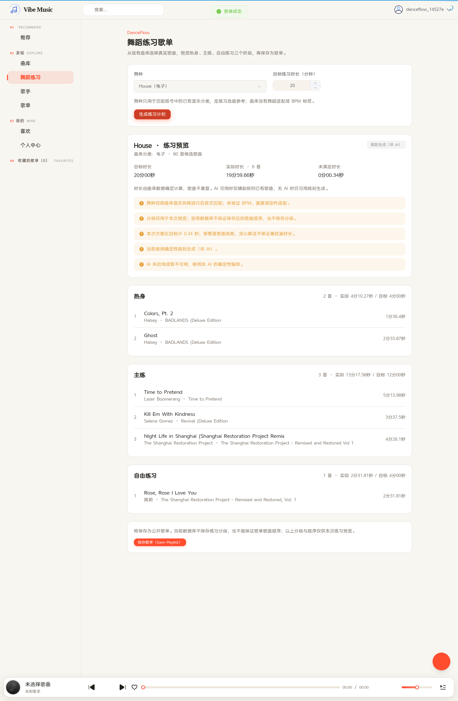
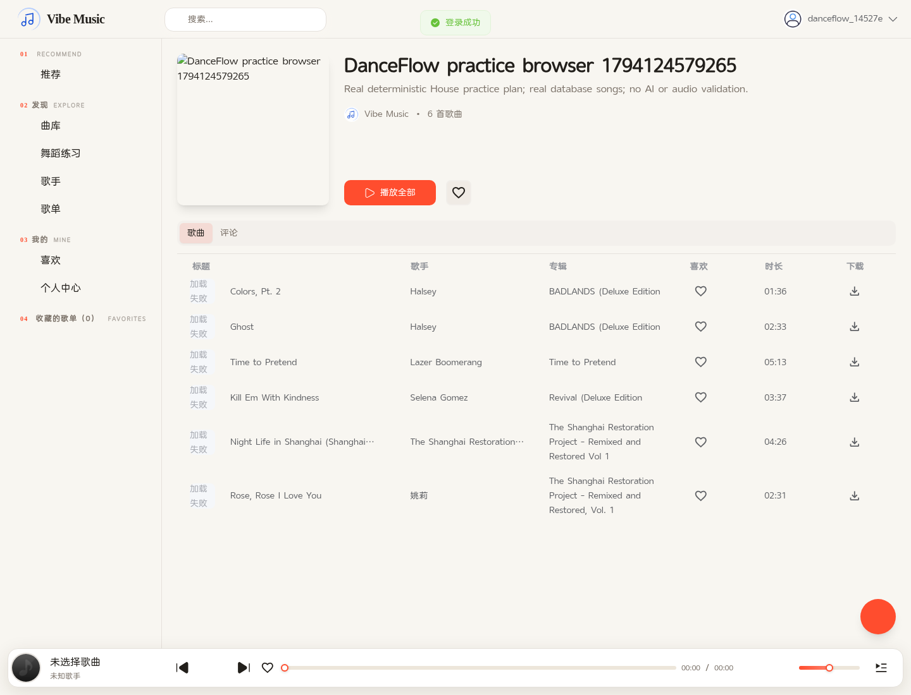
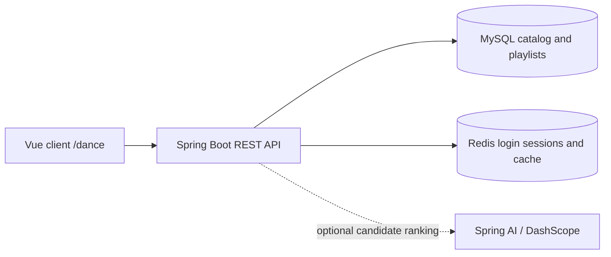

# DanceFlow

**A dance-practice playlist MVP extending the open-source Vibe Music platform.**

DanceFlow turns real catalog songs into a warm-up, main-practice and freestyle
preview, then saves the selected songs through an authenticated API. The working
local demo uses deterministic rules and needs **no AI API key**.

This is an extension of the Java/Spring Boot and Vue application originally
created by [Alex-LiSun](https://github.com/Alex-LiSun) and subsequently modified by
[zl1nq](https://github.com/zl1nq). The existing music platform, authentication,
player, administration UI and Spring AI assistant are reused, not presented as
work built from scratch. [LICENSE](LICENSE), [NOTICE](NOTICE) and attribution are
preserved.

## Implemented extensions

- A `/dance` interface for three style mappings and 5–90 minute practice targets.
- Three preview sections: warm-up, main practice and freestyle.
- Real database songs only, duplicate prevention, exact millisecond accounting,
  visible duration shortages, and a maximum of 50 selected songs.
- An optional Spring AI adapter that can rank a whitelist of catalog IDs; missing
  configuration, provider errors or invalid output produce an explicitly non-AI
  fallback. **No successful live LLM response has been verified.**
- An authenticated, transactional playlist-save API and Vue save dialog. Both the
  practice page and inherited assistant's song cards reuse this saving flow.
- A portable MySQL/Redis demo with generated local credentials, non-destructive
  initialization, real-service verifiers and 130 backend unit/MVC test cases.

## Demo screenshots

These are captures of the real Vue client using the real Spring Boot backend,
MySQL and Redis, with AI disabled. No API mocks or artificial AI replies were used.
Audio playback was not attempted; original media files are not included.



House maps to the catalog's electronic category. The verified plan contains six
real songs totaling **19 minutes 59.660 seconds**, with a **0.340-second shortfall**.
The individual section targets are approximate; only the total duration is a hard
upper bound.



## Technology stack and architecture

| Area | Technology | Origin / role |
| --- | --- | --- |
| Backend | Java 17 target, Spring Boot 3.5.16, Maven Wrapper | Existing application; extended with generation and saving |
| Persistence | MyBatis-Plus, MySQL 8 | Existing schema and mappers reused |
| Authentication/cache | JWT, Redis 7 | Existing security system reused; no administrator permissions granted |
| Client | Vue 3, TypeScript, Vite 6, Pinia, Element Plus, Tailwind CSS | Existing client plus the DanceFlow page and save dialog |
| Optional AI | Spring AI 1.1.2, Spring AI Alibaba 1.1.2.0 / DashScope | Existing provider; new constrained ranking adapter |
| Verification | JUnit, Mockito, Spring Test; Python standard library | Unit/MVC tests plus separate real-service checks |



```text
vibe-music-backend/
  vibe-music-server/       controllers, services, mappers and AI integration
  vibe-music-model/        request and response models, database entities
  vibe-music-common/       shared results, constants and utilities
vibe-music-client/        user-facing Vue application
vibe-music-admin/         inherited administration application; not required by demo
dev/demo/                local services, initialization and real-service verifiers
```

MinIO, SMTP and audio-player functionality belong to the inherited platform. They
are not required for the demonstrated generation/save workflow and were not
validated here. The admin application is outside the verified demo scope.

## How generation works

1. Map Hip-hop to 嘻哈说唱, House to 电子, or Jazz dance to 节奏布鲁斯.
   These are music-category heuristics, not verified dance annotations.
2. Query at most 200 matching catalog songs in stable ID order and reuse the
   existing artist-name lookup. Reject invalid durations and duplicate IDs.
3. Convert positive decimal seconds or strict `mm:ss` to integer milliseconds.
   Sub-millisecond fractions round upward.
4. Seed up to three shortest songs that fit, then greedily add the longest
   remaining whole songs that fit. The result never exceeds the total target,
   but the algorithm does not promise an optimal or exact duration match.
5. Order selected songs by validated AI preference when available, otherwise by
   ID, and make approximately 20%/60%/20% preview sections. Empty sections and
   shortages are reported rather than filled with invented songs.

The AI ranker cannot create IDs, change metadata/URLs, calculate durations, set
section budgets or write playlists. The inherited chat assistant separately has
read-only music tools; this generator is not a new autonomous tool-calling agent.
See [generator rules](vibe-music-backend/docs/dance-practice.md) and
[the reviewed AI/test boundaries](docs/portfolio-review.md).

## Run the local demo

Use a full **JDK 17+**, **Node.js 22+**, **pnpm 9.15.2**, **Python 3**, and Docker
with Compose v2 supporting `up --wait`. The latest validation used JDK 21 and
Node.js 24 on Linux. Internet access is needed to download dependencies/images.
The application does not require an AI key for this demo.

```bash
git clone --branch feat/danceflow-playlist-demo https://github.com/yixuansun37/vibe-music.git
cd vibe-music
python3 dev/demo/demo.py up
python3 dev/demo/demo.py bootstrap
cd vibe-music-backend
bash ./mvnw -B clean verify
cd ..
python3 dev/demo/demo.py start-backend
```

Keep that backend terminal open. Wait for `Started VibeMusicServerApplication` in
its private `dev/demo/.local/backend.log` before running verification. `JAVA_HOME`
should point to a full JDK. If Maven needs an existing proxy/settings file, build
with `bash ./mvnw -s "$MAVEN_SETTINGS" -B clean verify`; do not copy credentials or
session-specific proxy configuration into this repository.

In a second terminal, from the repository root:

```bash
cd vibe-music-client
pnpm install --frozen-lockfile
pnpm dev --host 127.0.0.1 --strictPort
```

Open the frontend on port **8090**, log in using only the generated `test_email`
and `test_password` fields from the private `dev/demo/.local/credentials.json`,
and select **舞蹈练习 → House → 20 minutes → 生成练习计划**. Preview the sections,
click **保存歌单（Save Playlist）**, enter a unique title and optional description,
then choose **查看歌单**. Do not publish the credentials file or screenshots of it.

Default local ports: backend **8080**, frontend **8090**, MySQL **3307**, Redis
**6380**. All demo services bind to loopback. The inherited HTTP client currently
uses `localhost:8080`; use a browser in the same environment or arrange access to
both frontend and backend ports. Forwarding only port 8090 is insufficient.
Optional non-secret overrides are in [dev/demo/.env.example](dev/demo/.env.example).

Generated credentials, external Spring configuration, logs and verification
reports stay in ignored `dev/demo/.local/`. Initialization retains existing data
and accounts. Do not delete only the credentials while retaining its MySQL volume.
Stop demo containers with `python3 dev/demo/demo.py down`; this retains the volume.
See [detailed setup](dev/demo/README.md) for configuration and troubleshooting.

## Verification results

Re-run against a ready backend, from the repository root:

```bash
python3 dev/demo/demo.py verify
python3 dev/demo/verify_practice.py
```

The second script explicitly saves the **House, 20-minute** generated selection,
then checks MySQL rows and the saved playlist detail. Each successful verifier
leaves one newly named demo playlist. No model response is mocked into these
real-service checks.

| Check | Latest recorded result | Scope |
| --- | --- | --- |
| Backend `bash ./mvnw -B clean verify` | 130 passed; 0 failed/errors/skipped | Unit/MVC tests; provider, Redis and persistence collaborators are mocked where appropriate |
| Client `pnpm build` | Passed | Production resource build |
| Client `pnpm type-check` | Failed: four pre-existing errors | `build/plugins.ts`, `ResetPasswordForm.vue`, two in `themeTools.ts`; no new diagnostics |
| Real MySQL/Redis verifiers | Passed | Login, 499-song catalog, generation, metadata/duration checks, save, SQL persistence and detail retrieval |
| Real browser workflow | Passed | Login → House 20 → generate → save dialog → saved detail; no API mocks |
| Live DashScope response | Not verified | AI ranker tests use a mocked `ChatModel` |
| Audio playback | Not verified | Original media is unavailable |

The 130 automated cases are **not** 130 live-service or AI integration tests.
The real browser check used environment-provided Playwright/Chromium; it is
separate from the project's dependency-free Python verifier. See
[review evidence and remaining limitations](docs/portfolio-review.md).

## Limitations and security scope

- Saved playlists are public/shared. The current schema has no owner/privacy or
  position fields and does not persist practice sections or guarantee song order.
- No BPM, tempo, energy or dance-suitability data is available. Section labels do
  not establish physiological suitability or training effectiveness.
- Greedy whole-song selection may leave a shortfall even when another combination
  would be closer. Candidate count and save size are bounded.
- Real AI ranking and inherited chat/tool calling require separate live-provider
  validation. The no-key demo disables DashScope; inherited AI chat is unavailable
  in this configuration, although its routes remain mapped. Use `/dance`.
- Existing frontend type errors and its fixed local backend address remain.
- This is a **local portfolio MVP, not a production-hardened service**. Inherited
  code uses legacy MD5 password hashing, a hard-coded JWT signing key and
  publicly accessible AI chat routes. Demo isolation is not a production remedy.
  Do not expose the demo directly to the public Internet.
- SQL metadata is not an audio license. No copyrighted audio was added; music
  playback and the inherited MinIO/SMTP/admin workflows remain outside this demo.

## Attribution and project materials

This project is a derivative work based on the original by
[Alex-LiSun](https://github.com/Alex-LiSun), licensed under the MIT License.
Modifications by [zl1nq](https://github.com/zl1nq) are also released under the MIT
License. DanceFlow adds the practice generator, authenticated playlist-save flow,
client integration, tests and reproducible demo to that existing work.

The original [LICENSE](LICENSE) and [NOTICE](NOTICE) are retained unchanged.
Original deployment and demonstration documentation remain available in
[docs/部署.md](docs/部署.md) and [docs/演示.md](docs/演示.md).
Accurate, copy-ready English resume bullets are in
[docs/resume-bullets.md](docs/resume-bullets.md).
